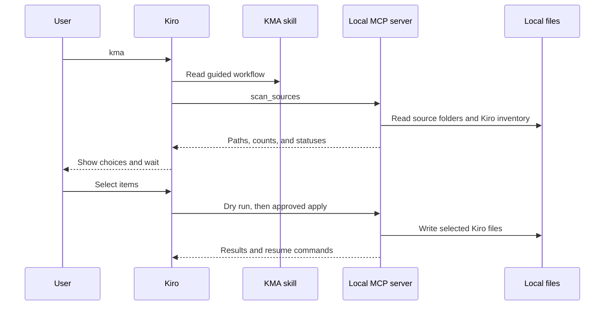
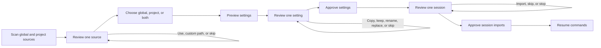

# Kiro Migration Assistant Architecture

## System Overview

Who runs what, and where:

```
  User ──▶ Kiro agent ──reads──▶ KMA skill (guided steps)
               │
               │ MCP over stdio (or: npx kma call <tool>)
               ▼
         KMA server ─── local process, no network
          │       │
   reads  │       │  writes, only after approval
          ▼       ▼
  ~/.claude      ~/.kiro
  ~/.cursor      <project>/.kiro
  ~/.codex
```

How data moves inside the server:

```
                     ┌─▶ Config:   convert ─▶ plan (dry run) ─▶ apply ─▶ rules, skills, commands, MCP, hooks
  Source adapter ────┤
  (one per tool)     └─▶ Sessions: transcript ─▶ V3 writer ─────────────▶ Kiro sessions + index
```

- Sources are read-only.
- Apply uses atomic writes and backs up replaced files.
- Conflicts wait for the user's choice.

## Kiro Integration

KMA contains a skill and an MCP server. Both run locally.

| Part | Installed location | Job |
|------|--------------------|-----|
| Skill | `~/.kiro/skills/kiro-migration-assistant/` | Tells Kiro how to scan, present choices, wait, and apply |
| MCP server | Registered in `~/.kiro/settings/mcp.json` | Provides five tools over stdio |

With Quick Setup, Kiro starts the server through:

```json
{
  "command": "npx",
  "args": ["-y", "github:irshadc/kiro-migration-assistant"]
}
```

On Windows the installer writes `"command": "cmd"` with `["/c", "npx", "-y", …]`, because `npx` there is `npx.cmd` and cannot be started without a shell.

`npx` gets the code from GitHub and caches it. Source settings and sessions stay on the local computer. KMA has no remote API and sends no migrated data to GitHub.

A newly added MCP server loads in the next Kiro session. During initial setup, the skill can call the same tools with `npx … call <tool>`.



## Components

| Name | File | Purpose | Trigger |
|------|------|---------|---------|
| CLI | `src/cli.js` | Start server, install, list tools, or call one tool | `npx`, `node` |
| Installer | `src/install.js` | Copy skill and merge MCP config | `install` |
| MCP server | `src/server.js` | Open stdio transport | Kiro or CLI |
| Tool definitions | `src/tools.js` | Zod schemas and result envelopes | MCP call |
| Root resolver | `src/roots.js` | Defaults, environment overrides, per-call paths | Every tool |
| Config planner | `src/config/migrate-config.js` | Discover, compare, filter, and apply | Config tools |
| Converters | `src/config/converters.js`, `src/config/agent-converters.js`, `src/config/hooks.js`, `src/config/kiro-legacy.js` | Convert settings to current Kiro formats | Planner |
| Kiro inventory | `src/config/kiro-inventory.js` | List existing Kiro items | Scan |
| Session importer | `src/sessions/import-sessions.js` | List, import, and hand off sessions | Session tools |
| Transcript converter | `src/sessions/transcript.js` | Build valid alternating turns and limit size | Importer |
| V3 writer | `src/sessions/kiro-v3-writer.js` | Write sessions and index entries | Importer |
| OS helpers | `src/common/platform.js` | Path module, shell quoting, and `cd` syntax per OS | Installer, importer, source adapters |
| Source adapters | `src/sources/` | Read Claude Code, Cursor, Codex, and Kiro IDE data | Scan/import |

## Project Structure

```
kiro-migration-assistant/
├── src/
│   ├── cli.js, install.js, server.js, tools.js
│   ├── roots.js
│   ├── common/
│   ├── config/
│   ├── sessions/
│   └── sources/
│       ├── claude-code/
│       ├── cursor/
│       ├── codex/
│       └── kiro/
├── skills/kiro-migration-assistant/SKILL.md
├── test/
│   ├── helpers/fixtures.js
│   ├── platform/            Simulated and native Windows, macOS, Linux tests
│   └── e2e/kiro-cli.test.js
├── README.md
└── package.json
```

## Event Flow



The loops represent separate user turns. Full tables appear only in explicit preview-all mode.

## Data Flow

Config flow:

```text
Local source files → adapter → neutral item → converter → plan → selected Kiro file
```

Session flow:

```text
JSONL/SQLite → Message[] → alternating turns → size limit → Kiro V3 records → session index
```

| Source | Main data |
|--------|-----------|
| Claude Code | `~/.claude`, `.claude`, Markdown agents, JSONL sessions |
| Cursor | `~/.cursor`, `.cursor`, Markdown agents, Cursor `User` SQLite stores |
| Codex | `~/.codex`, `.codex`, TOML agents, rollout JSONL, `config.toml` |
| Kiro IDE | `.kiro/hooks/*.kiro.hook` |

Every source tool supports a per-call `paths` override. `scan_sources.locationsByScope` returns the exact global and current-project paths with an existence flag; `configByScope` returns what each scope contains. A source override never changes the Kiro destination.

Source scope is preserved. User items go to `~/.kiro/`; workspace items go to `<workspace>/.kiro/`. Claude Code supports both scopes. Cursor rules are workspace-scoped. Codex `~/.codex/AGENTS.md` is user-scoped; a workspace `AGENTS.md` stays in place because Kiro already reads it.

## Agent Conversion

All generated agents use current Kiro JSON at `agents/<name>.json`.

| Source | Preserved in Kiro JSON | Warning-only fields |
|--------|-------------------------|---------------------|
| Claude Code Markdown | Prompt, tools, denied tools, skills as resources, inline/referenced MCP, hooks, model, safe restrictions | Permission modes without an exact safe mapping, memory, effort, isolation, background, turn limits |
| Cursor Markdown | Prompt, model, read-only restrictions | Background mode |
| Codex TOML | Developer instructions, model, disabled shell restriction | Reasoning settings and per-agent disabled skills |

The converter never turns a source bypass or auto-approval mode into broader Kiro permissions. An existing JSON or Markdown Kiro agent with the same name remains a conflict until the user keeps it, renames the incoming agent, or approves replacement with a backup.

Kiro V3 sessions use:

| Path | Content |
|------|---------|
| `~/.kiro/sessions/<bucket>/sess_<uuid>/session.json` | Session metadata |
| `~/.kiro/sessions/<bucket>/sess_<uuid>/messages.jsonl` | User and assistant turns |
| `~/.kiro/session-index/<bucket>.jsonl` | Session registration |

## Orchestration Pattern

| File | Pattern |
|------|---------|
| `skills/kiro-migration-assistant/SKILL.md` | Guided: one decision per turn; preview-all: read-only inventory; fast: one combined plan |
| `src/config/migrate-config.js` | Sequential plan and apply |
| `src/sessions/import-sessions.js` | Sequential import with per-session errors |

## MCP Tools

| Tool | Writes | Purpose |
|------|--------|---------|
| `scan_sources` | No | Show source paths, global/project counts, and current Kiro items |
| `migrate_config` | Only with `dryRun:false` | Plan or apply selected scopes and items; rename incoming conflicts when requested |
| `list_sessions` | No | List source sessions |
| `import_sessions` | Only with `dryRun:false` | Import selected or recent sessions |
| `handoff_session` | Yes | Import one session and return a resume command |

Every tool accepts `paths`. `migrate_config` also accepts `scopes` (`user`, `workspace`) and `renames` keyed by dry-run item ID. A conflict writes nothing until the user keeps the existing item, renames the incoming item, or approves replacement. Replacements are backed up; KMA never deletes an existing item.

## Testing Strategy

The test suite has two levels. Unit and protocol tests use an isolated generated home. End-to-end tests use the real kiro-cli but clean up the sessions they create.

Current verified state: 76 unit/protocol tests and 8 integration tests pass. The project does not yet collect line or branch coverage percentages, enforce a coverage threshold, or run tests in GitHub Actions. Coverage here means tested behavior, not a measured percentage.

### Unit and Protocol Tests

Run:

```bash
npm test
```

This runs 105 tests with Node's built-in test runner. Native tests for other operating systems are reported as skipped.

| Test file | Coverage |
|-----------|----------|
| `test/parsing.test.js` | Front matter, TOML, tool-name mapping, safe target names |
| `test/sources.test.js` | Claude JSONL, Cursor Agent, Cursor IDE SQLite, Codex JSONL, missing sources |
| `test/agent-converters.test.js` | Claude nested capabilities, Cursor and Codex agents, safe restrictions, malformed YAML, JSON/Markdown conflicts, inventory |
| `test/migrate-config.test.js` | Every config kind, global/project scopes, dry run, conflicts, incoming renames, backups, idempotency |
| `test/import-sessions.test.js` | Listing, import, handoff, forks, limits, corrupt rows, fallback folders |
| `test/kiro-v3-writer.test.js` | Folder hash, stable IDs, V3 files, index records, turn validation |
| `test/kiro-upgrade.test.js` | Kiro IDE hook conversion, item IDs, inventory, default behavior |
| `test/source-paths.test.js` | Reported scan paths, custom paths, `~/` expansion, invalid paths |
| `test/skill-flow.test.js` | One-decision guided flow, explicit bulk modes, README feature order and length |
| `test/cli.test.js` | Installer, idempotency, CLI calls, invalid input |
| `test/mcp-server.test.js` | Real MCP client/server exchange over stdio and error envelopes |
| `test/platform/simulated.test.js` | Windows, macOS and Linux behavior on any host: MCP server entry, shell quoting, resume command, path matching, Cursor folder decoding, data folders, rename retry |

Fixtures create realistic source trees and Cursor SQLite databases. They test reads and writes without touching the user's real settings or sessions.

### Operating System Tests

Run on the matching machine. Each file skips itself on other systems, and `npm test` includes them.

```bash
npm run test:windows
npm run test:macos
npm run test:linux
```

| Test file | Checks on the real OS |
|-----------|-----------------------|
| `test/platform/windows.test.js` | `cmd /c npx` starts where bare `npx` cannot, the resume command in PowerShell, drive-letter case in session buckets, `%APPDATA%`, writes that wait for a locked file |
| `test/platform/macos.test.js` | `npx` starts without a shell, the resume command in `sh`, case-sensitive buckets, `~/Library/Application Support/Cursor` |
| `test/platform/linux.test.js` | The same `sh` checks as macOS, plus `~/.config/Cursor` |

macOS and Linux share their checks through `test/platform/posix-checks.js`.

### Integration Tests

Run only on a machine with a logged-in kiro-cli:

```bash
npm run test:e2e
```

The eight integration tests in `test/e2e/kiro-cli.test.js` verify:

| Scenario | Proof |
|----------|-------|
| Resume imported history | Kiro answers from a converted Claude session |
| Skill and MCP handoff | A Kiro agent uses the skill and server, then returns a resume command |
| Session visibility | Imported sessions appear in `kiro-cli --v3 --list-sessions` |
| Guided migration | A Kiro agent migrates config and five sessions from generated sources |
| `kma` default flow | The first turn asks about one source and writes nothing |
| Global conflict rename | Kiro keeps an existing agent, copies the incoming global agent under a new name, and skips project agents |
| Agent JSON validation | Every generated Claude, Cursor, and Codex global/project agent passes `kiro-cli agent validate` |
| `kma` and custom folder | The short prompt scans relocated Claude data, prints that path, and writes nothing in preview mode |

The tests create a unique fixture project and session bucket. Cleanup removes that bucket and its index. A before/after check should show no unrelated change in `~/.kiro`.

### Release Checks

```bash
npm ci
npm test
npm run test:e2e
git diff --check
git status --short
```

A release is ready when both suites pass, docs match the current tool schemas, and only intended files are committed.

## Behavioral Notes

- Planning is read-only.
- Applying uses atomic file replacement.
- Existing different files remain conflicts until `overwrite:true`.
- Every replaced file gets a timestamped backup.
- SQLite opens read-only.
- Large JSONL files stream line by line.
- Imported tool calls become readable text; Kiro does not replay them.
- Long sessions keep the newest turns within `maxChars`.
- Sessions without a source folder use `fallbackCwd` or the global bucket.
- kiro-cli V2 sessions already resume in V3 and are not copied.
- Kiro V2 JSON agents are upgraded by kiro-cli and are not copied.
