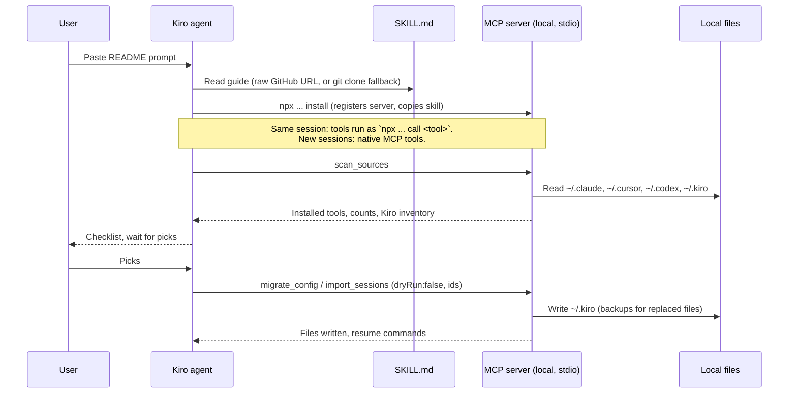
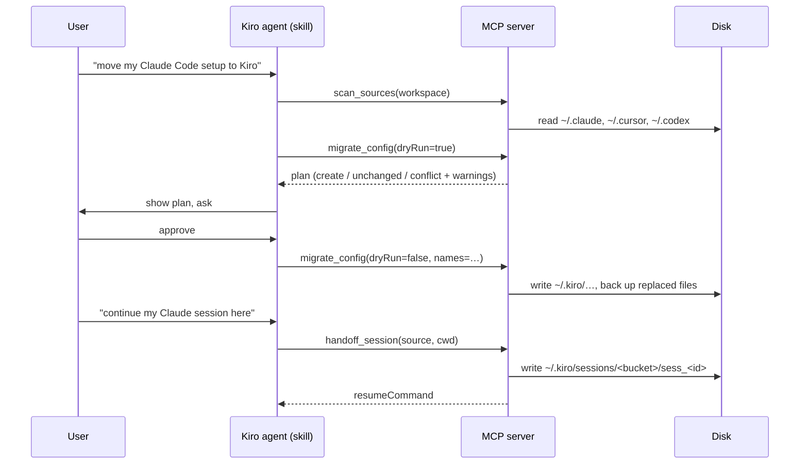

# Kiro Migration Assistant Architecture

## System Overview

```
┌──────────────────────────────────────────────────────────────┐
│                      INTERFACE TIER                          │
│  ┌──────────────────────┐     ┌───────────────────────────┐  │
│  │ Kiro agent + SKILL.md│ ──▶ │ MCP stdio server          │  │
│  │ (kiro-cli --v3 / IDE)│     │ src/server.js, tools.js   │  │
│  └──────────────────────┘     └─────────────┬─────────────┘  │
└─────────────────────────────────────────────┼────────────────┘
┌─────────────────────────────────────────────┼────────────────┐
│                      COMPUTE TIER           ▼                │
│  ┌───────────────────────────┐   ┌─────────────────────────┐ │
│  │ config/migrate-config.js  │   │ sessions/import-sessions│ │
│  │ discover→convert→plan→    │   │ read→turns→budget→write │ │
│  │ apply (backups)           │   │ handoff                 │ │
│  └────────────┬──────────────┘   └───────────┬─────────────┘ │
│               │  sources/<tool>/{config,sessions}.js         │
└───────────────┼──────────────────────────────┼───────────────┘
┌───────────────┼──────────────────────────────┼───────────────┐
│               ▼          DATA TIER (local)   ▼               │
│  READ: ~/.claude, ~/.claude.json, ~/.cursor, Cursor          │
│        state.vscdb (SQLite), ~/.codex, <workspace>           │
│  WRITE: ~/.kiro/{skills,agents,hooks,steering,settings},     │
│         <ws>/.kiro/..., ~/.kiro/sessions, ~/.kiro/session-index│
└──────────────────────────────────────────────────────────────┘
```

## Kiro Integration

The project ships two artifacts that Kiro uses together. Neither one calls a remote service at runtime.

| Artifact | Installed to | Loaded by Kiro | Role |
|----------|--------------|----------------|------|
| Skill `skills/kiro-migration-assistant/SKILL.md` | `~/.kiro/skills/kiro-migration-assistant/` (copied by `install`) | At session start, matched by its `description` | Drives the guided flow: which tool to call, what to show, when to wait for the user |
| MCP server `src/cli.js` → `src/server.js` | Entry `{"command":"npx","args":["-y","github:irshadc/kiro-migration-assistant"]}` in `~/.kiro/settings/mcp.json` | At session start, as a stdio child process | Reads source files and writes Kiro files through the 5 tools |

Where the code and the data come from:

| What | From | Network |
|------|------|---------|
| Package code | GitHub, fetched by `npx` and cached in the npm cache (`~/.npm/_npx`) | Only when `npx` resolves the package |
| Source config and sessions | Local folders resolved by `src/roots.js` | None |
| Written Kiro files | `~/.kiro/...` and `<workspace>/.kiro/...` | None |



Source folders come from `src/roots.js`: fixed defaults, then environment overrides (`CLAUDE_CONFIG_DIR`, `KMA_CLAUDE_JSON`, `KMA_CURSOR_DIR`, `KMA_CURSOR_USER_DIR`, `CODEX_HOME`, `KMA_KIRO_DIR`), then the per-call `paths` argument (`claudeDir`, `claudeJson`, `cursorDir`, `cursorUserDir`, `codexDir`), which `src/tools.js` adds to every tool and applies with `withSourcePaths`. `paths` changes only where sources are read; the Kiro target stays `KMA_KIRO_DIR` or `~/.kiro`. `scan_sources` returns `locations`, the folders it read and whether each exists, so the skill can show them and ask for a different folder when a tool is not found.

Example `handoff_session` result:

```json
{
  "source": "claude-code",
  "kiroSessionId": "sess_8a3e…",
  "status": "created",
  "turns": 42,
  "omittedTurns": 0,
  "resumeCommand": "cd '/home/me/app' && kiro-cli chat --v3 --resume-id sess_8a3e…"
}
```

## Three-Tier Architecture

| Tier | Layer | Components | Purpose |
|------|-------|------------|---------|
| 1 | Interface | `src/cli.js`, `src/install.js`, `src/server.js`, `src/tools.js`, `skills/kiro-migration-assistant/SKILL.md` | MCP tools with zod-validated input; skill that drives them |
| 2 | Business | `src/config/*`, `src/sessions/*` | Conversion, planning, conflict policy, session rewriting |
| 3 | Data | `src/sources/*`, `src/common/*` | Reading each tool's files and SQLite stores, atomic writes |

## Components

| Name | File | Runtime | Purpose | Trigger |
|------|------|---------|---------|---------|
| CLI entry | `src/cli.js` | Node ≥ 22.13 | npm bin: no args = MCP server; `install`, `tools`, `call <tool> <json>` | `npx`, Kiro `mcp.json` |
| Installer | `src/install.js` | Node | Adds the server to `~/.kiro/settings/mcp.json` (backup), copies the skill | `install` |
| MCP server | `src/server.js` | Node ≥ 22.13 | stdio transport, registers tools | CLI with no args; `node src/server.js` |
| Tool layer | `src/tools.js` | Node | Schemas, error envelope, no logic | MCP `tools/call`, CLI `call` |
| Config use case | `src/config/migrate-config.js` | Node | Discover, plan, apply, backup | `migrate_config`, `scan_sources` |
| Converters | `src/config/converters.js` | Node | Skill, command, agent, MCP, rule conversion (pure) | planner |
| Hook converter | `src/config/hooks.js` | Node | Claude/Cursor hooks → kiro-cli V3 hook file (`version: "v1"` is the file schema) | planner |
| Kiro IDE hooks | `src/config/kiro-legacy.js` | Node | `*.kiro.hook` (when/then) → V3 hook file; glob patterns → path regex | planner |
| Kiro inventory | `src/config/kiro-inventory.js` | Node | What Kiro already has per scope (skills, agents, MCP, hooks, steering) | `scan_sources` |
| Tool names | `src/config/tool-names.js` | Node | Claude tool → Kiro tool id map | converters |
| Session use case | `src/sessions/import-sessions.js` | Node | List, import, handoff, overwrite policy | session tools |
| Transcript model | `src/sessions/transcript.js` | Node | Neutral messages → alternating turns, budget | session use case |
| V3 writer | `src/sessions/kiro-v3-writer.js` | Node | Bucket hash, ids, records, index | session use case |
| Claude Code | `src/sources/claude-code/*` | Node | Sessions JSONL, config | registry |
| Cursor | `src/sources/cursor/*` | Node + `node:sqlite` | IDE composer DB, agent store/transcripts, config | registry |
| Codex | `src/sources/codex/*` | Node | Rollout JSONL, `config.toml` subset parser | registry |
| Kiro IDE | `src/sources/kiro/config.js` | Node | Finds `*.kiro.hook` (opt-in source `kiro`, not in the defaults) | registry |
| Roots | `src/roots.js` | Node | All paths; env overrides; per-call `paths` (`withSourcePaths`); `sourceLocations` for scan output | every adapter, every tool |

## Project Structure

```
kiro-migration-assistant/
├── src/
│   ├── cli.js, install.js              # npm bin: server, install, one-shot tool calls
│   ├── server.js, tools.js, roots.js   # interface + path resolution
│   ├── common/                         # files, front matter, sqlite helpers
│   ├── config/                         # config discovery, converters, planner
│   ├── sessions/                       # transcript model, V3 writer, import/handoff
│   └── sources/                        # claude-code/, cursor/, codex/, kiro/, index.js registry
├── skills/kiro-migration-assistant/    # Kiro skill (SKILL.md)
├── test/                               # node:test unit, CLI + MCP protocol tests
│   ├── helpers/fixtures.js             # generated fake home (incl. SQLite DBs)
│   └── e2e/                            # opt-in tests against real kiro-cli
└── progress.md                         # build checklist and verified facts
```

## Event Flow



## Data Flow

Sessions: source file → adapter → `Message[]` `{role, text, toolCalls, toolResults, timestamp}` → `toTurns` (merge same role, fold tool results into the assistant turn, truncate tool I/O) → `fitBudget` (newest turns within `maxChars`) → provenance note on the first user turn, closing assistant turn if needed → V3 records.

### Kiro V3 session store (written)

| Path | Content |
|------|---------|
| `~/.kiro/sessions/<bucket>/sess_<uuid>/session.json` | `schemaVersion, dataModelVersion, id, title, agentMode, workspacePaths, rootPaths, createdAt, lastModifiedAt, status` |
| `~/.kiro/sessions/<bucket>/sess_<uuid>/messages.jsonl` | `{id, timestamp, payload}`; payload `user` / `turn_start` / `assistant (operationType: Say)` / `turn_end` |
| `~/.kiro/session-index/<bucket>.jsonl` | `{"op":"add","sessionPath":"<bucket>/<id>","at":<ms>}` |

`bucket` = first 16 hex chars of SHA-256 of the normalized workspace path (`_global` without one). `sess_<uuid>` is a v5-style UUID of `source:sourceSessionId`, so a re-import targets the same session. Records this tool writes have ids prefixed `kma-`; any other record means the user continued in Kiro, and the session is then left alone (or forked).

These formats were read from the kiro-cli 2.26.1 agent engine and checked by the e2e test.

### Sources (read)

| Source | Location | Format |
|--------|----------|--------|
| Claude Code | `~/.claude/projects/<encoded-cwd>/<id>.jsonl` | JSONL; `isSidechain`/`isMeta` skipped |
| Cursor IDE | `<Cursor>/User/globalStorage/state.vscdb` `cursorDiskKV` | `composerData:<id>`, `bubbleId:<id>:<bubble>`; folder from `workspaceStorage` |
| Cursor Agent | `~/.cursor/projects/<enc>/agent-transcripts/*.jsonl`, `~/.cursor/chats/<h>/<id>/store.db` | JSONL; content-addressed blob tree |
| Codex | `~/.codex/sessions/**/rollout-*.jsonl` | `session_meta` + `response_item` |

### Config mapping

| Kind | Target | Notes |
|------|--------|-------|
| skill | `skills/<name>/` | folder copied; `name` forced to folder name; missing `description` derived |
| command | `skills/<name>/SKILL.md` | `$ARGUMENTS` note added; `allowed-tools` reported |
| agent | `agents/<name>.md` | `tools` mapped (absent → `*`); `model` dropped |
| mcp | `settings/mcp.json` | merged per scope; first source wins a name collision |
| hook (Kiro IDE) | `hooks/<name>.json` | `when.type` → V3 trigger (`fileEdited`→`PostFileSave`, `promptSubmit`→`UserPromptSubmit`, `agentStop`→`Stop`, …); `patterns` → regex `matcher`; `askAgent`/`runCommand` → `agent`/`command`; `enabled:false` kept |
| hook | `hooks/<source>-<file>.json` | Claude events map 1:1 (`PreToolUse`, `PostToolUse`, `UserPromptSubmit`, `Stop`, `SessionStart`, `SessionEnd`); matchers mapped to Kiro tool ids |
| rule | `steering/<name>.md` | `.mdc`: `alwaysApply`→always, `globs`→fileMatch, description only→auto, else manual |

## Orchestration Pattern

| File | Wraps | Pattern |
|------|-------|---------|
| `skills/kiro-migration-assistant/SKILL.md` | all tools | Guided, sequential: scan → user picks tools → dry-run checklist → user picks items (`ids`) → apply → user picks sessions → import → wrap up |
| `src/config/migrate-config.js` | source config adapters + converters | Sequential plan, then apply |
| `src/sessions/import-sessions.js` | session adapters + writer | Sequential per session; per-item errors |

## MCP/Tool Integration

| Name | Server | Purpose | Auth |
|------|--------|---------|------|
| `scan_sources`, `migrate_config`, `list_sessions`, `import_sessions`, `handoff_session` | `kiro-migration-assistant` (stdio) | See README | Local process; user's own file permissions |

## Behavioral Notes

- Planning reads only. Applying writes temp files and renames them, so a crash never leaves a half-written file.
- Existing targets with different content are `conflict` unless `overwrite:true`; replaced files and `mcp.json` are renamed to `*.kma-backup-<ts>`.
- Large JSONL files are streamed line by line; listing parses only the newest `limit` sessions and only their first lines.
- SQLite is opened read-only through `node:sqlite`, so there is no native build and Cursor's databases are never modified.
- Malformed JSONL lines (for example a live writer mid-line) are skipped; malformed JSON config files raise an error that names the file.
- Sessions with no recorded folder go to the `_global` bucket unless `fallbackCwd` is given; Kiro lists sessions per folder, so `_global` ones are resumable only by id.
- Corrupt Cursor composer records are left out of listings and fail per item with a named error.
- Tool inputs are truncated to 600 chars and outputs to 1500 chars per call in imported transcripts.
- Names from disk are sanitized to `[a-z0-9_-]`, so no target path can escape the Kiro directories.
- Every plan entry has a stable `id` (`source/kind/scope/name`); `ids` filters before planning, so a picked duplicate is planned on its own and is no longer a conflict.
- Default sources are the other agents only. The `kiro` source (Kiro IDE hooks) is read only when named, so existing calls behave as before.
- kiro-cli V2 sessions and V2 JSON agents are not migrated: kiro-cli 2.26.1 V3 lists and resumes V2 sessions by id, and upgrades V2 JSON agents in place (`allowedTools` → `permissions`, original kept as `.json.bak`).
- `scan_sources` counts sessions up to 500 per source (`countIsAtLeast` when capped).
